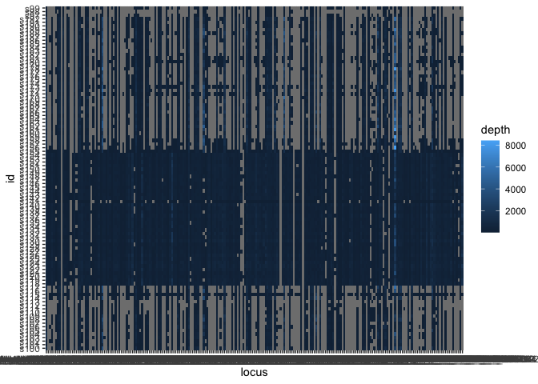
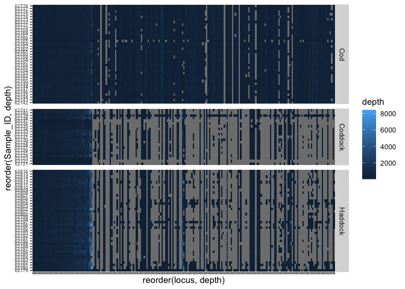
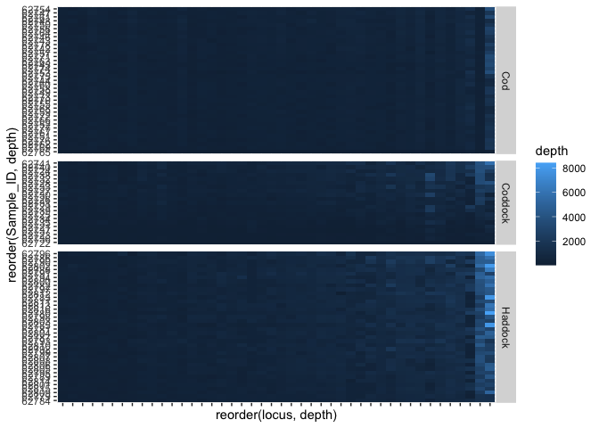
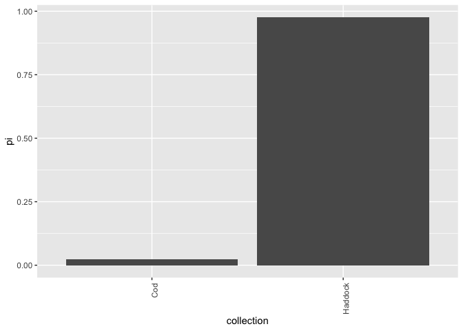
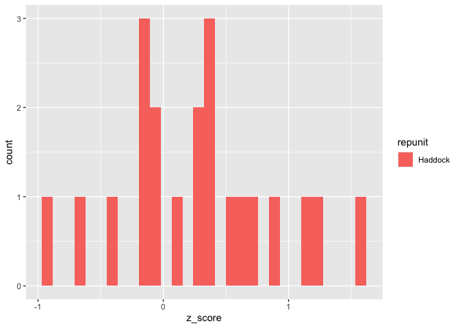
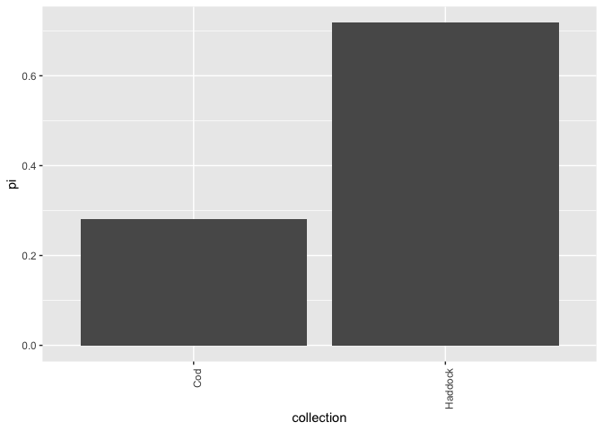
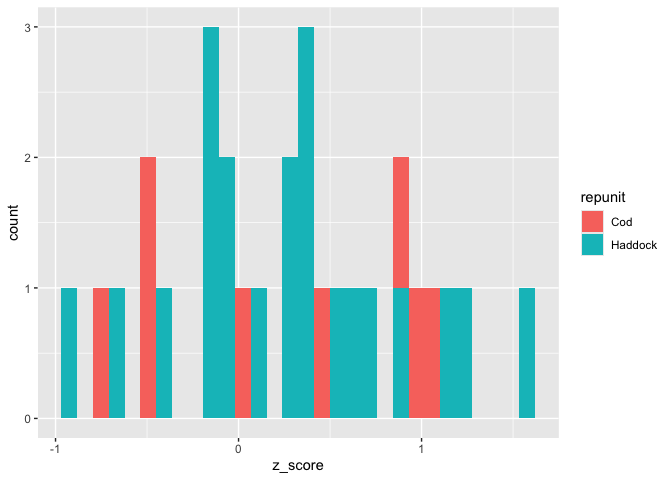

01-coddock-analysis
================
diana baetscher
2026-11-04

Background: “Coddock,” a putative hybrid between Atlantic cod and
haddock, were collected by fishermen and given to the Northeast
Fisheries Science Center.

The ABL Genetics Program received the putative hybrid samples as well as
reference samples for both Atlantic cod and haddock and genotyped all
samples using a set of microhaplotype markers designed in Pacific cod
(but using the Atlantic cod reference genome).

Illumina MiSeq data generated on 10-30-2026.

Data processed on the NOAA ’Omics high-performance computing cluster,
Sedna. Walkthrough of species id for unknown samples:

Using the rds file output from microhaplot:

1.  read in rds files

2.  apply read depth filters

3.  apply allele balance filter

``` r
# remotes::install_github("eriqande/rubias")
library(tidyverse)
```

    ## ── Attaching core tidyverse packages ──────────────────────── tidyverse 2.0.0 ──
    ## ✔ dplyr     1.2.1     ✔ readr     2.2.0
    ## ✔ forcats   1.0.1     ✔ stringr   1.6.0
    ## ✔ ggplot2   4.0.3     ✔ tibble    3.3.1
    ## ✔ lubridate 1.9.5     ✔ tidyr     1.3.2
    ## ✔ purrr     1.2.2     
    ## ── Conflicts ────────────────────────────────────────── tidyverse_conflicts() ──
    ## ✖ dplyr::filter() masks stats::filter()
    ## ✖ dplyr::lag()    masks stats::lag()
    ## ℹ Use the conflicted package (<http://conflicted.r-lib.org/>) to force all conflicts to become errors

``` r
library(readxl)
library(stringr)
library(lubridate)
library(rubias)


source("../R/rockfish-funcs2.R")


#### Call genos from the microhaplot rds files ####

# the directory with the rds file
dir <- "../data/rds_files/"


# cycle over them, read them and add the gtseq_run column on each.
# at the end, bind them together.
genos_long <- call_genos_from_haplotRDS(path = file.path(dir, "coddock_test.rds"))
```

    ## Joining with `by = join_by(id, locus, rank)`

``` r
#### In the end, let us get a data frame that includes genotypes for all the individuals  ####
# and which explicitly has NAs in places where data are missing
genos_long_explicit_NAs <- genos_long %>%
  select(id) %>%
  unique() %>%
  unlist() %>%
  unname() %>%
  expand.grid(id = ., locus = unique(genos_long$locus), gene_copy = 1:2, stringsAsFactors = FALSE) %>%
  as_tibble() %>% 
  left_join(., genos_long) %>%
  arrange(id, locus, gene_copy)
```

    ## Joining with `by = join_by(id, locus, gene_copy)`

``` r
genos_long_explicit_NAs %>%
  ggplot(aes(x = locus, y = id, fill = depth)) +
  geom_tile()
```

<!-- -->

Lots of missing data, but that’s not surprising because of the mismatch
between species.

So let’s ignore the missing data for now.

``` r
# ABLG metadata
meta <- read_xlsx("../data/20261015_Coddock.xlsx")

# samplesheet
ss <- read_csv("../data/20261029_325_326_One26PST_1thru6.csv", skip = 19) 
```

    ## Rows: 768 Columns: 9
    ## ── Column specification ────────────────────────────────────────────────────────
    ## Delimiter: ","
    ## chr (9): Sample_ID, Sample_Plate, Sample_Well, I7_Index_ID, index, I5_Index_...
    ## 
    ## ℹ Use `spec()` to retrieve the full column specification for this data.
    ## ℹ Specify the column types or set `show_col_types = FALSE` to quiet this message.

``` r
ss_info <- ss %>%
  mutate(row_id = row_number(), .before = 1) %>%
  filter(Sample_Project == "Coddock") %>%
  mutate(species = str_replace(Description, "_.*$", ""))

# add putative species ID to the ABLG numbers
df_w_spp <- genos_long_explicit_NAs %>%
  mutate(row_id = str_replace(id, "s", "")) %>%
  mutate(row_id = as.numeric(row_id)) %>%
  left_join(., ss_info) %>%
  select(species, Sample_ID, locus, gene_copy, allele, depth, allele.balance)
```

    ## Joining with `by = join_by(row_id)`

Oh man, do we have data that links to the ABLG numbers?

Were there loci that dropped in all samples?

``` r
df_w_spp %>%
  group_by(species) %>%
  ggplot(aes(x = reorder(locus, depth), y = reorder(Sample_ID, depth), fill = depth)) +
  geom_tile() +
  facet_grid(rows = vars(species), space = "free", scales = "free") +
  theme(
    axis.text.x = element_blank(),
    axis.text.y = element_text(size = 6)
  )
```

<!-- -->
I wonder if there’s some utility in just using the loci without missing
data. Even though there’s a ton of information in the patterns of
missing data…

Goal: filter just to the smaller number of markers with no missing data
across all three groups.

``` r
loc_list <- df_w_spp %>%
  filter(!is.na(allele)) %>% # non-missing data
  group_by(locus) %>%
  tally() %>%
  arrange(desc(n)) %>%
  filter(n == 192)
```

``` r
df_locs <- df_w_spp %>%
  inner_join(loc_list) 
```

    ## Joining with `by = join_by(locus)`

``` r
df_locs %>%
  ggplot(aes(x = reorder(locus, depth), y = reorder(Sample_ID, depth), fill = depth)) +
  geom_tile() +
  facet_grid(rows = vars(species), space = "free", scales = "free") +
  theme(
    axis.text.x = element_blank()
  )
```

<!-- -->
44 loci without missing data across all three groups.

``` r
# first make integers of the alleles
alle_idxs <- df_locs %>% 
  dplyr::select(species, Sample_ID, locus, gene_copy, allele) %>%
  group_by(locus) %>%
  mutate(alleidx = as.integer(factor(allele, levels = unique(allele)))) %>%
  ungroup() %>%
  arrange(Sample_ID, locus, alleidx) # rubias can handle NA's, so no need to change them to 0's

# and spread the alleles
two_col <- alle_idxs %>%
  #group_by(indiv, locus) %>%
  unite(loc, locus, gene_copy, sep = ".") %>%
  #ungroup() %>%
  select(-allele) %>%
  pivot_wider(names_from = loc, values_from = alleidx) 
```

``` r
# baseline
reference <- two_col %>%
  filter(species %in% c("Cod", "Haddock")) %>%
  mutate(sample_type = "reference") %>%
  rename(indiv = Sample_ID) %>%
  rename(repunit = species) %>%
  mutate(collection = repunit) %>%
  select(sample_type, repunit, collection, indiv, everything())
```

``` r
# mixture
rubias_mix <- two_col %>%
  filter(species == "Coddock") %>%
  mutate(sample_type = "mixture", collection = "putative_coddock", repunit = NA) %>%
  select(sample_type, repunit, collection, everything()) %>%
  rename(indiv = Sample_ID) %>%
  select(-species)
```

## Mixture assignment with rubias

``` r
rubias_output <- infer_mixture(reference = reference, mixture = rubias_mix, gen_start_col = 5)
```

    ## Collating data; compiling reference allele frequencies, etc.   time: 0.03 seconds
    ## Computing reference locus specific means and variances for computing mixture z-scores   time: 0.00 seconds
    ## Working on mixture collection: putative_coddock with 21 individuals
    ##   calculating log-likelihoods of the mixture individuals.   time: 0.00 seconds
    ##   performing 2000 total sweeps, 100 of which are burn-in and will not be used in computing averages in method "MCMC"   time: 0.04 seconds
    ##   tidying output into a tibble.   time: 0.01 seconds

``` r
# mixing proportions
rubias_output$mixing_proportions %>%
  ggplot(aes(x = collection, y = pi)) +
  geom_bar(stat = "identity") +
  theme(
    axis.text.x = element_text(angle = 90, hjust = 0.95)
  )
```

<!-- -->

``` r
# take the top output for each sample
top_assign <- rubias_output$indiv_posteriors %>%
  group_by(indiv) %>%
  slice_max(., order_by = PofZ)

top_assign
```

    ## # A tibble: 21 × 10
    ## # Groups:   indiv [21]
    ##    mixture_collection indiv repunit collection  PofZ log_likelihood z_score
    ##    <chr>              <chr> <chr>   <chr>      <dbl>          <dbl>   <dbl>
    ##  1 putative_coddock   62721 Haddock Haddock        1          -33.0 -0.380 
    ##  2 putative_coddock   62722 Haddock Haddock        1          -31.0 -0.0427
    ##  3 putative_coddock   62723 Haddock Haddock        1          -23.6  1.21  
    ##  4 putative_coddock   62724 Haddock Haddock        1          -31.5 -0.119 
    ##  5 putative_coddock   62725 Haddock Haddock        1          -27.6  0.538 
    ##  6 putative_coddock   62726 Haddock Haddock        1          -30.1  0.119 
    ##  7 putative_coddock   62727 Haddock Haddock        1          -21.4  1.58  
    ##  8 putative_coddock   62728 Haddock Haddock        1          -31.3 -0.0842
    ##  9 putative_coddock   62729 Haddock Haddock        1          -24.1  1.11  
    ## 10 putative_coddock   62730 Haddock Haddock        1          -31.4 -0.106 
    ## # ℹ 11 more rows
    ## # ℹ 3 more variables: n_non_miss_loci <int>, n_miss_loci <int>,
    ## #   missing_loci <list>

I think the only additional thing I could think of is blinding a handful
of the known cod samples and seeing if they’re correctly assigned to
cod.

``` r
# check z-scores
top_assign %>%
  ggplot(aes(x = z_score, fill = repunit)) +
  geom_histogram()
```

    ## `stat_bin()` using `bins = 30`. Pick better value `binwidth`.

<!-- -->
Everything looks like a haddock. No issues with z-scores and including
just the 44 markers for which there’s no missing data across Cod,
Haddock, and putative coddock.

Quick check:

``` r
test2 <- two_col %>%
  mutate(species = ifelse(Sample_ID %in% c(62771:62778), "Coddock", species))
  

# baseline
reference <- test2 %>%
  filter(species %in% c("Cod", "Haddock")) %>%
  mutate(sample_type = "reference") %>%
  rename(indiv = Sample_ID) %>%
  rename(repunit = species) %>%
  mutate(collection = repunit) %>%
  select(sample_type, repunit, collection, indiv, everything())


# mixture
rubias_mix <- test2 %>%
  filter(species == "Coddock") %>%
  mutate(sample_type = "mixture", collection = "putative_coddock", repunit = NA) %>%
  select(sample_type, repunit, collection, everything()) %>%
  rename(indiv = Sample_ID) %>%
  select(-species)
```

## Mixture assignment with rubias

``` r
rubias_output <- infer_mixture(reference = reference, mixture = rubias_mix, gen_start_col = 5)
```

    ## Collating data; compiling reference allele frequencies, etc.   time: 0.03 seconds
    ## Computing reference locus specific means and variances for computing mixture z-scores   time: 0.00 seconds
    ## Working on mixture collection: putative_coddock with 29 individuals
    ##   calculating log-likelihoods of the mixture individuals.   time: 0.00 seconds
    ##   performing 2000 total sweeps, 100 of which are burn-in and will not be used in computing averages in method "MCMC"   time: 0.04 seconds
    ##   tidying output into a tibble.   time: 0.01 seconds

``` r
# mixing proportions
rubias_output$mixing_proportions %>%
  ggplot(aes(x = collection, y = pi)) +
  geom_bar(stat = "identity") +
  theme(
    axis.text.x = element_text(angle = 90, hjust = 0.95)
  )
```

<!-- -->

``` r
# take the top output for each sample
top_assign <- rubias_output$indiv_posteriors %>%
  group_by(indiv) %>%
  slice_max(., order_by = PofZ)

# check z-scores
top_assign %>%
  ggplot(aes(x = z_score, fill = repunit)) +
  geom_histogram()
```

    ## `stat_bin()` using `bins = 30`. Pick better value `binwidth`.

<!-- -->
Perfect. Now I can see the real cod samples that I switched to unknowns
and none additional. That makes me feel confident in the power of the
genetic markers and the mixture analysis.
